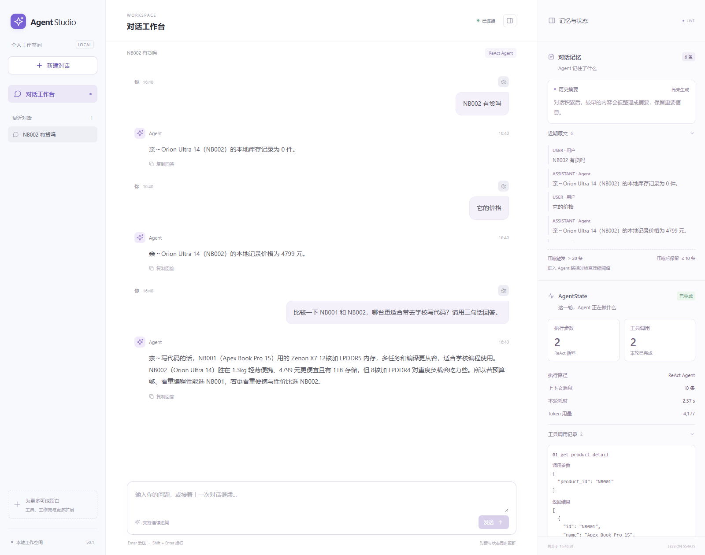

# Intelligent Question Answering Agent

An e-commerce question-answering agent built with ReAct, tool calling, hybrid retrieval, and structured conversation memory.

The system handles product recommendations, product specifications, inventory questions, and customer-support knowledge queries. A lightweight intent router sends simple requests to deterministic replies or fixed workflows, while open-ended requests continue through the ReAct loop.

## Workspace preview



A real session in the FastAPI workspace: an inventory lookup, a follow-up price query, and a model-generated laptop comparison using the bundled sample catalog. The inspector displays the session's actual memory and execution state. In this captured run, the comparison completed in two ReAct steps with two product-detail tool calls.

## Highlights

- **FastAPI conversation workspace**
  - A three-column interface with conversation management, chat, and a memory/state inspector.
  - Live state polling, tool-call inspection, and per-turn token and latency reporting.
  - Display history stays available after older Agent context is summarized.
- **Intent routing and fixed workflows**
  - Direct replies for greetings, acknowledgements, and requests that need clarification.
  - Deterministic workflows for single-product inventory, price, and specification queries.
  - ReAct for recommendations, comparisons, multi-step tasks, and requests that require dynamic tool selection.
- **ReAct execution core**
  - Tool calling, argument parsing, validation feedback, tool-result observation, loop limits, and final-answer fallback.
  - Session management is separated from the execution loop.
- **Unified local tool provider**
  - Tool schemas and local lookup entries are built from one definition table.
  - Pydantic models generate the model-facing JSON Schema and validate tool arguments before execution.
  - Tools return validated JSON strings with explicit error propagation.
- **RAG knowledge retrieval**
  - FAQ, guides, policies, and help documents are indexed in Qdrant.
  - BGE-M3 embeddings and BM25 keyword retrieval are available through a hybrid RRF retriever.
  - The knowledge-search tool is connected to the default Agent through a lazily initialized RAG service.
- **Conversation memory**
  - Recent user/assistant messages are combined with an incremental LLM-generated summary after the conversation grows beyond the configured threshold.
  - Tool traces remain separate from user-visible replies.
- **Dependency and lifecycle management**
  - The composition root owns shared LLM, tool, and retrieval resources.
  - The default LLM and RAG dependencies are initialized lazily when a request actually needs them.

## Architecture

```text
CLI / FastAPI Web Workspace
  └── Application
        └── ConversationRunner
              ├── IntentRouter
              ├── ProductQueryWorkflows
              └── ReActExecutor
                    └── LocalProvider
                          ├── local product/inventory functions
                          └── knowledge-search function

Knowledge search:
LocalProvider → LazySearchService → RagSearchAdapter → Retriever
                                      ├── Qdrant vector search
                                      └── BM25 + RRF hybrid search
```

## Requirements

- Python 3.11+
- A DeepSeek-compatible chat API for normal Agent requests
- Ollama with the `bge-m3` embedding model for RAG queries and ingestion
- `qdrant-client` for the local Qdrant store

Install Python dependencies:

```bash
python -m pip install -r requirements.txt
```

Copy `.env.example` to `.env` and set `DEEPSEEK_API_KEY`. `LLM_MODEL` is optional.

## Run the CLI

```bash
python main.py
```

The default application loads local product and inventory data and exposes four tools:

- `search_products`
- `get_product_detail`
- `check_inventory`
- `search_knowledge`

Product and inventory requests use local data. The Qdrant client and embedding service are initialized only when the knowledge-search tool is first used.

## Run the web workspace

The FastAPI workspace provides a three-column interface: a sidebar for conversations and future extensions, a chat panel, and an inspector for conversation memory and `AgentState`.

```bash
python -m uvicorn web.app:app --host 127.0.0.1 --port 8000
```

Open [http://127.0.0.1:8000](http://127.0.0.1:8000). The frontend is served by FastAPI and does not require Node.js or a separate build step.

- Create, switch, and delete conversations. Each conversation has its own runner, history, and state; a browser cookie scopes access to its conversations.
- Inspect the actual incremental summary, recent messages, routing decision, ReAct step count, tool arguments/results, model usage, and full state. The page polls during execution; the final answer appears when the turn completes.
- Display history is kept separately from Agent memory, so summarizing older context does not remove chat bubbles.
- The existing composition root supplies the real local tools and lazy RAG service. Greetings and queries such as `NB001 有货吗` work without model requests; open-ended requests require the configured model API.
- Agent turns are queued across conversations because the current core shares lazy dependencies and a model usage log. Blocking execution runs outside the web event loop, keeping state and health endpoints responsive.

This is a local development workspace. Conversations live in process memory and disappear on restart. Run one server worker; multiple workers would have separate session stores. Browser scoping is not account authentication. The existing CLI entry point remains available.

Web code: `web/app.py` handles HTTP and resource lifecycle, `web/sessions.py` manages conversations and execution, and `web/static/` contains the interface. Interactive API documentation is available at `/docs`.

To reproduce the conversation in the screenshot, send these questions in the same session:

| Query | Execution path | What it demonstrates |
| --- | --- | --- |
| `NB002 有货吗` | Fixed workflow | Reads the local inventory record through `check_inventory`. |
| `它的价格` | Fixed workflow | Resolves the product reference from recent conversation history and calls `get_product_detail`. |
| `比较一下 NB001 和 NB002，哪台更适合带去学校写代码？请用三句话回答。` | ReAct Agent | Fetches both product records and uses the configured model to compare their specifications. |

The first two requests do not call the model. The comparison requires `DEEPSEEK_API_KEY`; its wording and usage can vary between runs. These examples use sample product data, not a live retail inventory feed.

## Build the knowledge index

The offline ingestion command loads FAQ and long-form knowledge documents, chunks them, creates BGE-M3 embeddings, and rebuilds the `knowledge` collection:

```bash
python -m rag.ingest
```

Make sure Qdrant local storage and Ollama are available before running ingestion. The generated local database under `rag/qdrant_data/` is intentionally ignored by Git.

## Test

The test suite uses local data and model/service doubles; it does not require live model requests for the normal test run:

```bash
python -m unittest discover -s tests -v
```

The tests cover routing boundaries, fixed workflow validation, tool-provider wiring, lazy resource initialization, conversation isolation, and error handling. Web integration tests also cover browser isolation, live state observation, request deduplication, execution queuing, and preservation of the display transcript after memory compaction.

The current offline regression suite contains 60 tests, including evaluation-integrity checks and fixture validation across Windows/Unix line endings.

## Evaluation notes

The evaluation harness runs the real conversation entry point, records model/tool/retrieval events, and compares the current router against an all-ReAct baseline. It includes 100 **draft synthetic scenarios**, with a 30-scenario pilot; labels and the provisional acceptance split still require independent human review.

```bash
# Validate draft scenarios and fixture fingerprints without model calls
python -m eval.run_agent --validate-only

# A small paired run using the configured model and real local tools
python -m eval.run_agent --rag skip --ids single_product-01 context-02 --variants routed react --max-calls 12 --max-tokens 20000

# Knowledge-only retrieval ablation; reranking is explicitly enabled
python -m eval.run_retrieval --limit 5 --reranker llm

# Fixed-transcript comparison: full history, recent 10 messages, incremental summary
python -m eval.run_memory --limit 1
```

Each run writes raw evidence, configuration fingerprints, metrics and a Markdown report under `eval/results/`. Execution completion is separate from task correctness: semantic judgments remain pending until reviewed. Failed calls with unavailable usage are reported as unknown cost. Isolated workers enforce time limits, and call/token budgets bound subsequent requests. Missing retrieval dependencies are reported as unavailable rather than scored as zero-quality retrieval.

See [the evaluation guide](docs/EVALUATION.md) for review import, budgets, cost accounting, full runs and limitations. Historical retrieval reports remain historical: the current RAG evaluation uses the 190 knowledge queries from the original 270-query set, and verifies rerank score coverage before treating a rerank as successful.

### Measured retrieval baseline — October 16, 2026

All **190 knowledge queries** completed against the real Qdrant index and Ollama BGE-M3 service; all 190 DeepSeek reranking responses passed score-coverage validation. Product queries are excluded because products are now served by local business tools.

| Configuration | Hit@1 | Hit@5 | Hit@20 | MRR@5 | Mean retrieval latency |
| --- | ---: | ---: | ---: | ---: | ---: |
| Vector | 77.89% | 98.42% | 100% | 86.49% | 42.60 ms |
| Vector + BM25, RRF | 77.89% | 97.37% | 100% | 86.04% | 49.81 ms |
| Hybrid + Top-20 LLM reranking | **83.68%** | **98.95%** | 100% | **90.08%** | 1,559.36 ms |

Reranking improved Hit@1 by **5.79 percentage points** over vector search, at an average additional **1.51 seconds** over hybrid retrieval. The reranking experiment used **190 model calls and 431,480 tokens**. Hybrid retrieval alone did not improve overall Hit@1 and reduced Hit@5 on this set; FAQ and long-document results moved in different directions.

This is one run on a known development set with one designated target document per query. Hit@K measures target-document retrieval, not final-answer correctness or exhaustive recall. Local serial timings are not a concurrency SLA. The default Agent still uses hybrid retrieval **without reranking**; this experiment does not change that default. These results are not directly comparable with the historical 270-query experiment.

The [full benchmark report](docs/RAG_EVALUATION_2026-10-16.md) includes subgroup results, regressions, uncertainty and limitations. The [versioned evidence bundle](docs/evaluations/2026-10-16/README.md) preserves rankings, raw reranker scores, usage and fingerprints, with an offline verifier. See [evaluation findings and follow-up experiments](docs/EVALUATION_FINDINGS_2026-10-16.md) for reusable lessons and the remaining work.

## Project status

The core Agent, local tool layer, intent routing, fixed workflows, conversation summarization, default RAG tool wiring, and FastAPI web workspace are implemented. RAG-side production hardening remains open, including atomic index replacement, strict embedding-response validation, BM25 cache invalidation, pagination for large collections, robust long-paragraph chunking, and retry/circuit-breaker policy for external dependencies.

## License

No license has been selected yet.
